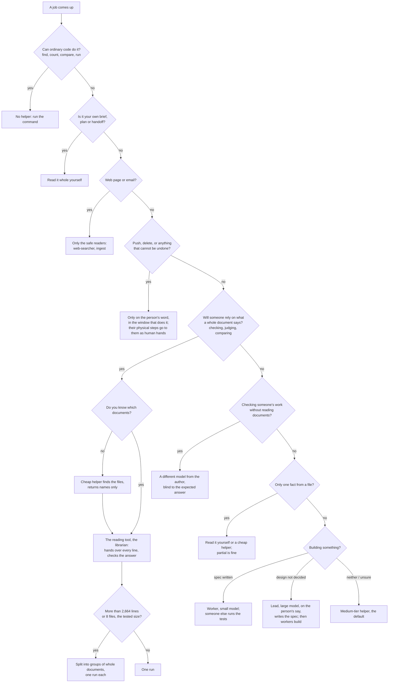

## Read This First

- **Purpose:** a helper (a sub-agent: a separate model session a window spawns to do one job and report back) saves the window's context and money, but its report is a claim, not a result. This SOP keeps the model tier matched to the job, the brief good enough for the job, and the report checked before it is acted on. Every model choice here is made by tier (small, medium, large), not by a model's name.
- **Use it when:** you spawn a helper; you write or change a shipped helper agent's model line; a scheduled job needs a model; a helper hands back work and you are about to rely on it.
- **Don't use it when:** you are deciding which window runs at which tier, how windows hand work to each other (the role handoff: passing a live role to another window), or whether to trust a report from another window — `canon/coordinating-windows-sop.md`. How the per-turn delegation line reaches a session — `canon/context-injection-sop.md`. Building a helper agent's file — the tier pin and the tool wall are described here (see Tiers and `system/tools/test_agent_pins.py`); no other canon document covers it. The already-written lessons on helpers sharing a checkout, stalling, and safety stops — `canon/build-conformance-sop.md` §7 (pointed to, not repeated).
- **Covers:** the tier table; the routing order for interactive helpers; the one model-id table for scheduled jobs; briefing; accepting a helper's work.
- **Doesn't cover:** cheap-helper mode — a cheaper outside model made the default for helpers. It is personal practice, not part of the harness, so it is out of this SOP; what a helper on an outside model may see is the person's own decision. Also not covered: the cost line a scheduled job writes (`canon/cron-jobs-sop.md` §9); the door that refuses a hard-coded model id (`canon/hook-sop.md`, "a hard-coded model id outside the one table is refused").
- **How this SOP changes:** only through Enver's ruling; superseded text moves to the history file named in the header.
- **Which situation are you in?**
  - Picking a model for a helper → The Procedure, "Choosing the model".
  - Writing the helper's instructions → "Briefing a helper".
  - A helper has reported back → "Accepting a helper's work".
  - A scheduled job needs a model → "A scheduled job calls a model".

## Desired Outcome

Every helper runs on a named tier chosen for its job; no spawn inherits the window's model by default; scheduled jobs name a tier and call the one wrapper; and nothing a helper reports is acted on until its effect has been checked by the caller.

**How to check:** `python3 system/tools/test_agent_pins.py` passes (every shipped agent pins a model and declares its tool list); `bash system/tools/tests/test_no_hardcoded_model_ids.sh` passes; `bash system/hooks/tests/test_delegation_override.sh` passes; for any accepted helper output, the caller can name the file, diff or source line it opened to confirm it.

## Before You Start

- The routing order for interactive helpers is in the harness brief, `CLAUDE.md` section "Sending work to a sub-agent".
- The shipped helper agents and their model and tool lines: `.claude/agents/*.md`.
- The tier table for scheduled jobs: `system/tools/model.lib.sh` (Python reads it through `shared/tools/model_ids.py`).

## Principles

- **Name a tier, not a model id; the id lives in one table.** Why: model ids retire, and a retired id fails headless while a fail-safe wrapper hides the exit — the email danger path had not once worked headless and nothing said so. Change if: the platform keeps retired ids answering, shown by a headless call to a retired id succeeding. Evidence: OBSERVED — `canon/hook-sop.md:186-190`, dated 2026-10-28.
- **Scheduled model calls go through the one wrapper `canon/cron-jobs-sop.md` §9 describes, `run_model`.** Why: each job copying its own guardrails is how they drift. Change if: jobs calling the model directly show no more drift or silent failures than jobs using the wrapper. Evidence: OBSERVED — `canon/cron-jobs-sop.md:167`; `system/tools/model.lib.sh:1-24`.
- **The small tier takes mechanical lookups (a file, a search, one fact, a shape check) and tool-less readers behind a Read-only wall; a helper with any tool beyond Read whose reading has to summarize, compare or judge goes to the medium tier or above.** Why: the earlier wording "pure read-only" let a window send summarizing to the small tier, while a reader with no tool but Read is safe by its wall, not its model. Change if: the small tier matches the medium tier on summarizing and judging, measured on real helper jobs. Evidence: CANDIDATE — the delegation line's rewording, `system/hooks/inject_delegation_standing.sh:50-51` (2026-11-05); `CLAUDE.md:221-228`; `canon/security-canon.md:72`.
- **The standing delegation line stays registered for every session the harness starts; its delivery is described in `canon/context-injection-sop.md`.** Why: when the line was unregistered, windows stopped seeing it and helpers ran on the window's own model; why it has to ride in the person's turn is in `canon/context-injection-sop.md`. Change if: sessions without the line are shown to delegate and pin as often as sessions with it. Evidence: OBSERVED — `system/hooks/inject_delegation_standing.sh:48-51` (re-registered 2026-11-05).
- **Work the person steers, and the high-judgment work, stays in the main session; a document the window has to act on is read whole by the window, not through a helper's summary.** Why: a helper removes the person's gate from a steered loop, and a summary loses what the window needed to judge. Change if: a delegated steered loop or a helper-summarized document is shown to keep the person's gate and the decisive detail. Evidence: CANDIDATE — `.claude/skills/advisory-council/SKILL.md:45,176` (the chaired loop runs in the main session); the person has ruled that the main window keeps the high-judgment work and reads such documents whole.
- **Cheap for verbatim and mechanical work, strong for judgment someone relies on; and check the values a cheap model returns, not only their format.** Why: moving a classifying step to a cheaper model moves the recognition with it. Change if: a cheaper tier matches the stronger one on the values, measured over repeated runs of the real job. Evidence: RESEARCHED — `canon/canonical-principles-sop.md:944`; `canon/skill-building-sop.md:373`.
- **A cheap tier is correct behind a structural wall: a reader with no tool but Read can do nothing itself if hijacked, provided what it returns reaches the actor as tight typed data, never free text (`canon/security-canon.md:72`).** Why: the wall carries the safety, so a stronger model buys nothing there. Change if: decode-and-judge accuracy at the small tier degrades on real attacks. Evidence: RESEARCHED — `system/ingestion-reader-contract.md:150-153`, tested 2026-07-03 in the system this harness was ported from, not yet here; `canon/security-canon.md:72`.
- **Cost tracks error rate, not model price; a cheaper model can cost more.** Why: per-step errors compound into retries and rework that dwarf the price difference. Change if: measured cost-to-done for a job falls when it moves to a cheaper tier with no rise in rework. Evidence: RESEARCHED — `canon/canonical-principles-sop.md:479-484` (§4.8).
- **Reshape the context before reaching for a bigger model.** Why: most quality problems trace to context being wrong — a missing fact, or bloat — more than to the model being too small. Change if: a job that failed with corrected context passes only on a larger tier, repeatedly. Evidence: RESEARCHED — `canon/canonical-principles-sop.md:356-358`.
- **Delegation is decided at planning time, not as a mid-task reflex.** Why: a mid-task "use sub-agents" works once; only structure makes fan-out the default. Change if: mid-task delegation requests hold across a session as reliably as planned fan-out. Evidence: RESEARCHED — `canon/canonical-principles-sop.md:943`.
- **The helper's account of its own work is not evidence; check the effect.** Why: a helper can be right about the reason and still destroy the thing, then report success honestly. Change if: helper self-reports are shown to match checked effects across blind sessions. Evidence: OBSERVED — `canon/canonical-principles-sop.md:387-392` (§4.1).
- **A claim that nothing is missing needs a deterministic check, not a model's word.** Why: models are structurally worst at noticing absence. Change if: an in-system test shows helpers finding omitted content as reliably as a mechanical diff. Evidence: RESEARCHED — `canon/canonical-principles-sop.md:397-400` (§4.2).
- **Check a helper's work with a different model family, or a stricter filter than the helper used — not the same session re-reading its own work (a separate window on the same model is a real layer; a different family is stronger).** Why: self-critique amplifies its own bias with no new information. Change if: same-family checks catch errors at the same rate as cross-family ones here. Evidence: OBSERVED — `canon/canonical-principles-sop.md:412-416` (§4.3, observed here 2026-09-04/05).
- **Agreement among helpers on the same base model is correlated, not independent confirmation, unless their sources are independent.** Why: helpers sharing a model share its priors, so their agreement can be the same error repeated. Change if: same-model helpers given the same sources are shown here to miss planted errors independently. Evidence: RESEARCHED — `.claude/skills/research/SKILL.md:37,67`.
- **A cheap model run as a judge on every turn is a rubber stamp.** Why: the stop-hook judge flagged no real violation across many live turns and slowed each call badly. Change if: a cheap judge shows a usable true-negative rate on real turns. Evidence: OBSERVED — `canon/hook-sop.md:144-150`, dated 2026-07-12/13.
- **Hand off work with enough context; hand off a check without the expected answer, as a rule of thumb.** Why: a context-starved worker makes hidden conflicting choices, while a checker handed the answer confirms it. Change if: checkers given the expected answer catch planted errors as often as blind ones. Evidence: OBSERVED — `canon/canonical-principles-sop.md:1136-1148` (§12.g, 2026-09-10/11; Enver ruled the boundary a judgment call, 2026-10-30).
- **Output kept without its check carries a visible "unverified" label.** Why: when the check is skipped, the label is the only sign a later reader gets that the output was not checked. Change if: unlabelled unchecked output is shown not to reach canon or later decisions. Evidence: CANDIDATE — commit `66a96a9`, 2026-11-02, shows a labelled unverified landing; nothing yet shows the label stopping one.
- **One run is not a result for anything model-shaped.** Why: a behaviour that works part of the time reads as a clean pass or a clean fail depending on the day. Change if: repeated runs of model-shaped checks here agree with their first run. Evidence: RESEARCHED — `canon/canonical-principles-sop.md:490-494` (§4.9, measured 2026-09-11).

## The Procedure

### Choosing the model

**The chart for choosing a helper** (approved by Enver 2026-11-19; landed 2026-11-20). The hook `system/hooks/inject_helper_chart.sh` prints it from between these markers at a session's first helper launch; it holds no copy.

<!-- helper-chart:start -->

<!-- helper-chart:end -->

1. **Do:** decide whether a helper is needed at all — use the smallest tool that does the job (`canon/canonical-principles-sop.md` §5.12).
   - **Expect:** a helper only where the work is separable and its result can be checked.
2. **Do:** classify the job with the routing order in the harness brief (`CLAUDE.md`, "Sending work to a sub-agent"), first match wins, and read off the tier below; a job that fits no row takes the medium tier, the default for helpers.
   - **Why:** the order asks two things — is it retrieving or deciding, and can the caller cheaply check the answer; "Lossy or unverifiable → not cheap, even when the task looks mechanical" (`CLAUDE.md:229-231`).

   | Tier | Scheduled-job name / agent model line | Jobs | Shipped agents on it |
   |---|---|---|---|
   | small | `small` / `haiku` | mechanical lookups: a file, a search, one fact, a shape check; a tool-less reader of untrusted text behind a Read-only wall | `worker`, `ingest-reader`, `ingest-tagger` |
   | medium | `medium` / `sonnet` | the default for helpers; reading that summarizes, compares or judges; reading untrusted content for meaning with any tool beyond Read; driving many tool calls in a row; judgment someone relies on without re-checking | `archivist`, `sentinel`, `web-searcher`, `ingest-conclusions` |
   | large | `large` / `opus` | the deliberate exceptions, where the reasoning is the deliverable; the person decides when the large tier runs | the advisory council's advisors (`.claude/skills/advisory-council/SKILL.md:25-36,127`); the autoplan review lenses `canon`, `value`, `postmortem`, `skills-sop` (`.claude/skills/autoplan/lenses/`) |

3. **Do:** name the model on the spawn, or in the agent file's `model:` line.
   - **Why:** a spawn with no model takes the `CLAUDE_CODE_SUBAGENT_MODEL` setting where the session's launcher sets one (the harness's own test launchers set it to the medium tier), and otherwise inherits the window's model, often the most expensive tier; so a model line is replaced, not deleted.
   - **Expect:** the conformance friction on this choice is light by design: the every-turn delegation line (a sign) reminds the session to pin a model, the launcher default catches a spawn without one, and `system/tools/test_agent_pins.py` (a test, run on the shipped agent files) fails when an agent file loses its model or tool line. No hook checks the model on each spawn.
   - **Check:** `python3 system/tools/test_agent_pins.py` passes.
4. **Do:** if an operator wants a different routing policy for their own machine, put it in the override file the delegation hook reads (`$LIFEHACK_DELEGATION_OVERRIDE`, by default `$HOME/.config/lifehack/delegation-override.txt`).
   - **Expect:** a non-empty file's text replaces the whole default line every turn, the pin-a-model sentence included, so restate anything you still want; an empty or missing file leaves the default (`system/hooks/inject_delegation_standing.sh:63-74`).
   - **Check:** `bash system/hooks/tests/test_delegation_override.sh` passes.

### Briefing a helper

1. **Do:** for work whose result will be merged, give the helper the context the job needs; for a check, usually leave out the answer you expect (where that line falls is a judgment call; the person ruled it so on 2026-10-30).
   - **Why:** missing context loses decisions; shared context shares the bias (§12.g).
2. **Do:** brief and supervise the helper as `canon/build-conformance-sop.md` §7 describes (output paths, reporting deviations, batching, stalls, safety stops).
3. **Do:** leave the spawn unnamed unless the helper has to be addressable; if it is named, tell it in the prompt to send its full text back.
   - **Why:** a named helper's final text is discarded when it finishes.
   - **Expect:** `system/hooks/guard_agent_return_channel.sh` (a hard block on the plain case; a text match, so a negated "sendmessage" gets past it, `canon/canonical-principles-sop.md:1335`) refuses a named spawn whose prompt states no way back.

### Accepting a helper's work

1. **Do:** before acting on a report, re-check every factual claim you will act on against its source — the diff, the file, the source line.
   - **Why:** "Every claim re-checked before it is acted on" — a handed-over report once carried several wrong claims, all caught by opening the file (`canon/canonical-principles-sop.md:1043-1046`, DNR2). Reports between windows: `canon/coordinating-windows-sop.md`.
   - **Check:** for each claim you acted on, you can name what you opened; several same-model helpers agreeing does not replace this.
2. **Do:** for a claim that nothing is missing, run a mechanical check (a diff, a count, a search) rather than accept the helper's word, and first see that check fail on known-bad input.
   - **Why:** a checker can itself be presence-only; test it on known-bad input before trusting it passing (`canon/canonical-principles-sop.md:395`, 2026-10-28).
3. **Do:** if the output is unusable, re-run once on the next tier up and say so; from the medium tier, ask the person before using the large tier.
   - **Why:** escalation answers unusable output; a helper saying it is unsure is not a reason, because hedging is not failure (`CLAUDE.md`, "Sending work to a sub-agent").
4. **Do:** if you keep output you have not checked, label it unverified where it lands.

### A scheduled job calls a model

1. **Do:** name a tier in the job's row and call `run_model` from `system/tools/model.lib.sh`; the wrapper's contract is in `canon/cron-jobs-sop.md` §9.
   - **Check:** `bash system/tools/tests/test_no_hardcoded_model_ids.sh` passes.
2. **Do:** to change which model a tier means, edit only the table at the top of `system/tools/model.lib.sh`.

## When Something Goes Wrong

- **If a spawn's report does not arrive:** check whether it was named without a way back (Briefing step 3); for a stalled helper, see `canon/build-conformance-sop.md` §7.6.
- **If the pin test fails:** add or restore the agent's `model:` and `tools:` lines; do not delete a pin to save cost.
- **If a scheduled job fails with "unknown model tier" or exits with a model error:** check the row names `small`, `medium` or `large`, and that no literal id was added.
- **If a helper's claim does not match what you opened:** discard the claim, re-run on the next tier (ask the person first if that is the large tier) or do it yourself, and say so in your own report.
- **To undo:** a model or tier change is one line in the agent file or the table; revert that line.
- **Stop and ask the person when:** a helper hit a safety stop (`canon/build-conformance-sop.md` §7.4); a job seems to need the large tier routinely, or a new large-tier use is proposed; a check would mean trusting output nobody can verify.

## Don't Retry

- **Stricter mechanical checks of whether a skill's dispatch is pinned** — each produced false positives, because "is this dispatch properly pinned" is a meaning question. Proof: `system/tools/test_agent_pins.py` (module docstring).
- **Deleting a model pin to save cost** — the spawn then takes the launcher's default model or, where none is set, the window's, raising cost silently. Proof: `system/tools/test_agent_pins.py`, `test_every_agent_pins_a_model`.
- **A cheap model as a per-turn judge** — a rubber stamp, and slow. Proof: `canon/hook-sop.md:144-150`.
- **Unregistering the delegation line as a personal preference** — windows stopped seeing it and helpers ran on the window's model; its delivery is owned by `canon/context-injection-sop.md`. Proof: `system/hooks/inject_delegation_standing.sh:43-51`.
- **A hook on every spawn that refuses or defaults a helper started without a named model** — built and removed the same day: the person ruled out a hook firing on every sub-agent start to police its model; model choice is held by the delegation line and the launcher default instead. Proof: the person's ruling, 2026-11-05.

## Pointers

- **Rulings behind this SOP:** the person's rulings, stated here in plain words: the default helper tier is medium (2026-11-14); the person decides when the large tier runs; cheap-helper mode is personal practice; no hook checks the model on each spawn (2026-11-05). How much context a helper or checker gets: `canon/canonical-principles-sop.md` §12.g (2026-10-30, canon).
- **Evidence:** `system/tools/model.lib.sh`; `shared/tools/model_ids.py`; `system/tools/test_agent_pins.py`; `system/tools/tests/test_no_hardcoded_model_ids.sh`; `system/hooks/tests/test_delegation_override.sh`; `system/hooks/guard_agent_return_channel.sh`; `.claude/agents/*.md`; `system/ingestion-reader-contract.md`; commit `66a96a9`.
- **Words used here:** **helper** — a sub-agent spawned to do one job and report back. **Tier** — small, medium or large: a class of model, mapped to an id in one table. **Pin** — the model line on a spawn or agent file. **Delegation line** — the one line injected every turn saying helpers are standing-authorized, how to pin them, and that a document someone will rely on goes to the reading tool, otherwise the chart. **Wall** — the tool list an agent is limited to.

## History

- 2026-11-15 — first draft, written as built from the V2 tree. Older wording: none.

## References (work in progress)

Where the concepts above meet the code. Work in progress: entries are added as the harness changes.

- `CLAUDE.md`, section "Sending work to a sub-agent" — the harness brief's first-match routing order for interactive helpers.
- `.claude/agents/*.md` — the shipped helper agents; each file's `tools:` line is its wall and its `model:` line its pin.
- `system/tools/test_agent_pins.py` — test: every shipped agent declares a tool list and pins a model; the untrusted-content readers hold Read only.
- `system/hooks/inject_delegation_standing.sh` — every-turn sign: helpers are standing-authorized, pin a model, which tier for which job; for a whole document someone will rely on, the reading tool, otherwise the chart.
- `$LIFEHACK_DELEGATION_OVERRIDE` (default `$HOME/.config/lifehack/delegation-override.txt`) — operator file whose text replaces the delegation line whole.
- `system/hooks/tests/test_delegation_override.sh` — test: the override file replaces the default line, and an empty or missing file leaves it.
- `system/register/register.jsonl` — the hook register; its row keeps the delegation line wired for every session.
- `CLAUDE_CODE_SUBAGENT_MODEL` — Claude Code setting a launcher may set; the model an unpinned spawn takes.
- `system/hooks/guard_agent_return_channel.sh` — hard block on a named spawn whose prompt states no way to send its report back.
- `system/tools/model.lib.sh` — the one tier table (`small`, `medium`, `large` to model id) and `run_model`, the wrapper scheduled jobs call.
- `shared/tools/model_ids.py` — Python callers read a tier's id from the same table.
- `system/tools/tests/test_no_hardcoded_model_ids.sh` — test: no literal model id outside the table.
- `system/tools/install-schedulers.sh` — the scheduled-job door; refuses a job row with a hard-coded model id.
- `system/ingestion-reader-contract.md` — the untrusted-content reader's contract, including its cheapest-tier test and batching by size.
- `.claude/skills/advisory-council/SKILL.md` — the council: large-tier advisors, chaired loop kept in the main session.
- `.claude/skills/autoplan/lenses/` — autoplan's review lenses; four pin the large tier.
- `.claude/skills/research/SKILL.md` — research skill; notes that same-model searchers' agreement is correlated.
- **not built yet:** every scheduled job script calls the model through `run_model`. Serves: not yet in canon.
- **not built yet:** the parked scripts that still name model ids move onto tiers, emptying the test's parked list. Serves: not yet in canon.
- **not built yet:** a per-job write permission for a scheduled model step, scoped to the job's own output folder. Serves: not yet in canon.
- **not built yet:** a tool wall on the root `agents/sentinel.md` copy, or its removal. Serves: not yet in canon.
